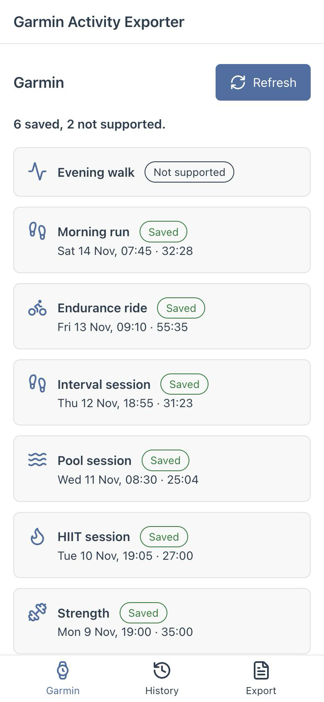
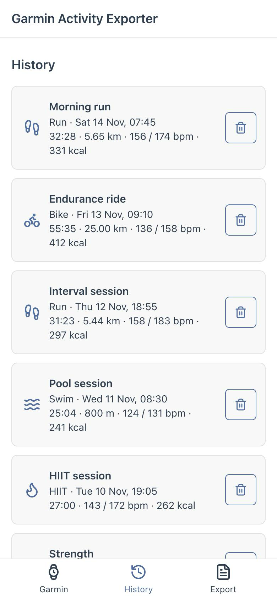
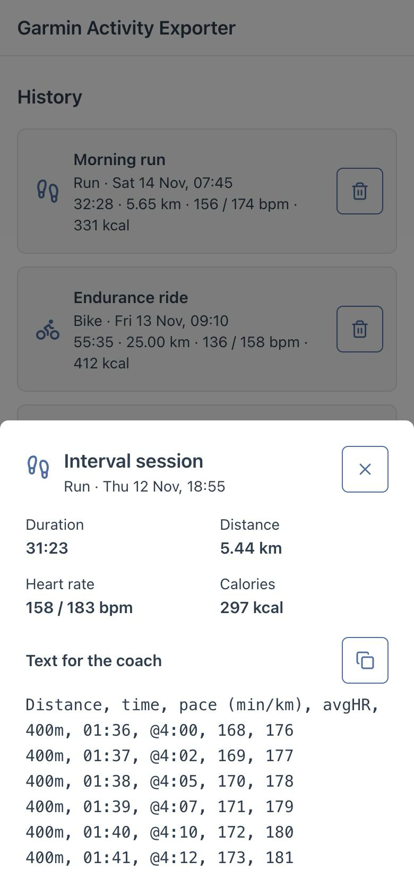
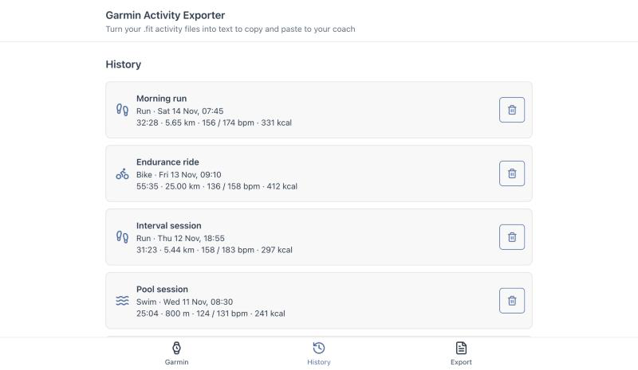
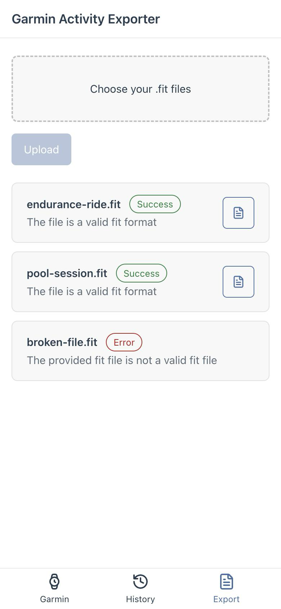
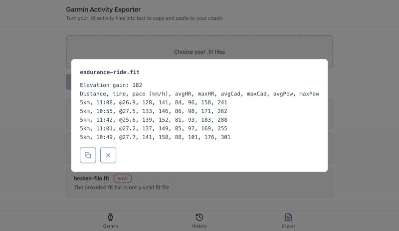
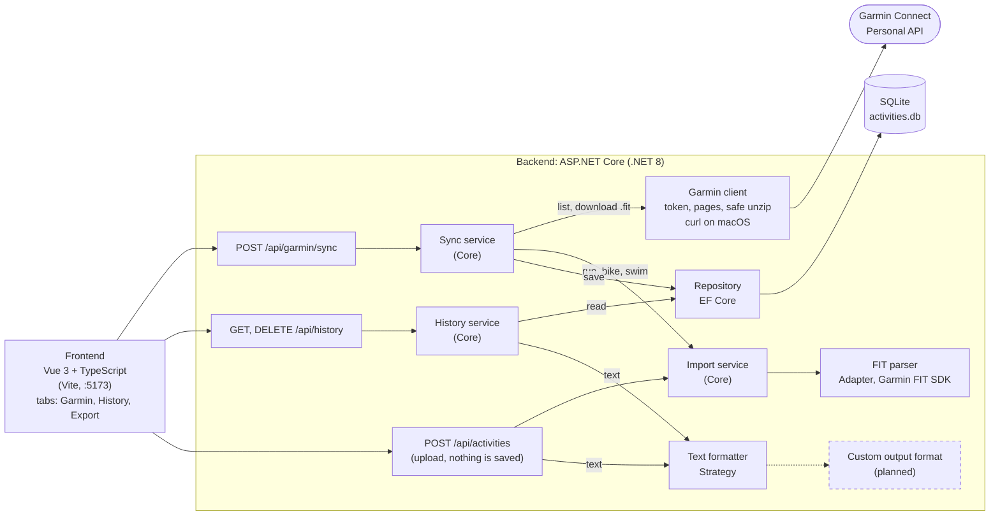

# Garmin Activity Exporter

Web app that brings your activities from Garmin Connect into a local history and turns each one into structured plain text, ready to copy and paste to your coach.

> [!NOTE]
> **Portfolio project**, built step by step while exploring C#, ASP.NET Core and Vue. It works end to end for one user on one computer: sync from Garmin, history, copy the text, or export a single `.fit` file without saving it. See [Status](#status) for what is done and what is next.

> [!IMPORTANT]
> Unofficial project, not affiliated with or endorsed by Garmin. It uses Garmin's **Personal API**, which is meant for your own data only: every person who runs this app creates their own key and nobody shares it (see [Good to know](#good-to-know)).

## Why

This project started from a personal need. I train with a coach, and every week I had to send him my results by copying numbers by hand from Garmin Connect. It was slow and error-prone.

So I built a tool that takes my activities, keeps only the **work** of each one (no warm-up, rests or cool-down) and writes a compact text I can paste straight into a message to my coach, in a format I designed myself.

## How it works

The app has three tabs.

**Garmin.** Press **Refresh** and the backend asks the Garmin Personal API for the activities of the last 30 days. The ones it does not know yet are saved in the history automatically:

- **Run, bike and swim**: the `.fit` file is downloaded and read with the FIT SDK. The history keeps the splits, so the text for the coach can be written whenever you open the activity.
- **HIIT and strength**: saved with the numbers Garmin gives in its list (duration, heart rate, calories). There is no text for them yet.
- **Everything else** (a walk, a hike, a virtual ride...): only listed, with its name and a default icon. Nothing is downloaded or saved.

A refresh downloads at most 20 files; if more are waiting, it says so and the next refresh continues. A failed activity never stops the others.

**History.** One card per saved activity, newest first. Open one to see its numbers and the text for the coach, with a button to copy it. The text is written again every time from the saved data (it is never stored), so a change of the output format reaches the old activities too. Delete an activity and it stays deleted: the next refresh does not bring it back.

**Export.** Upload one or more `.fit` files and get the text, **without saving anything**. It is for files that do not come from Garmin Connect, for example a Zwift ride that you would otherwise find twice in the history.

The pace unit depends on the sport (min/km for running, min/100 m for swimming, km/h for cycling), and a ride also has cadence and power columns, with a dash when the sensor is missing.

## Screenshots

<table>
  <tr>
    <td align="center"><br><sub>Garmin: the outcome of a refresh</sub></td>
    <td align="center"><br><sub>History: one card per activity</sub></td>
    <td align="center"><br><sub>The text for the coach: only the work</sub></td>
  </tr>
</table>

The same app on a computer: the content stays in a central column.



Export a single `.fit` file without saving it, with one outcome per file:



The text to paste to your coach for a ride, with a button to copy it:



*The screenshots use made-up activities and synthetic `.fit` files, not real data.*

## Tech stack

- **Backend:** C# / ASP.NET Core (.NET 8), minimal APIs
- **Database:** SQLite with EF Core (one local file, no server)
- **Parsing:** Garmin activity files (`.fit`), read with the official [Garmin FIT SDK](https://www.nuget.org/packages/Garmin.FIT.Sdk) for .NET
- **Frontend:** Vue 3 + TypeScript, Vue Router, [UnoCSS](https://unocss.dev/) (utility classes, [Lucide](https://lucide.dev/) icons), mobile first with a bottom navigation bar
- **Tests:** xUnit (backend, 208 tests), Vitest and Vue Test Utils (frontend, 126 tests)

## Architecture



Dashed = planned, not implemented yet.

`Core` has no external dependencies: the services only know interfaces (`IGarminActivitySource`, `IActivityRepository`, `IActivityParser`, `IActivityFormatter`), so they are tested with fakes, without a network, a database or ASP.NET. The adapters (Garmin client, EF Core repository, FIT parser, text formatter) live in `Api`.

## Project structure

```
backend/    ASP.NET Core solution
            ActivityExporter.Core    models, interfaces and services: import, Garmin sync, history (no external dependencies)
            ActivityExporter.Api     endpoints, Garmin client, EF Core repository, FIT parser, text formatter
            ActivityExporter.Tests   xUnit tests
frontend/   Vue 3 + TypeScript app (Vite)
screenshots/  images of the README
```

## Getting started

You need the [.NET 8 SDK](https://dotnet.microsoft.com/download), [Node.js](https://nodejs.org/) 22 or newer, and `curl` (it is already there on macOS and on most Linux systems). Run the backend and the frontend in two terminals.

### Garmin key (only for the Garmin tab)

1. On Garmin Connect (web) open the [Personal API key page](https://connect.garmin.com/app/settings/personalApiToken), create a key, accept the terms and choose when it expires (30 days to a year). **The key is shown once.**
2. Give it to the app with the .NET *user secrets*, which are saved outside the project folder, so the key cannot end up in a commit:

```bash
cd backend
read -s "k?Garmin API key: " && dotnet user-secrets set "Garmin:ApiKey" "$k" --project ActivityExporter.Api; unset k
```

(`read -s` does not show what you paste and does not leave it in the history of your shell. The line above is for zsh; in bash use `read -s -p "Garmin API key: " k`.)

Without a key the Export tab works the same; the Garmin tab says that the key is missing.

### Backend

```bash
cd backend
dotnet run --project ActivityExporter.Api --launch-profile http
```

The API listens on `http://localhost:5171`. The database is created by itself at the first start, as `backend/ActivityExporter.Api/activities.db` (it is ignored by git: it contains your training data). To start again from zero, stop the app and delete that file.

### Frontend

```bash
cd frontend
npm install
npm run dev
```

Open `http://localhost:5173`. During development Vite forwards the requests to `/api` to the backend, so no extra configuration is needed.

### Try the API

With the backend running:

```bash
curl -F "files=@/path/to/activity.fit" http://localhost:5171/api/activities   # text for one file, nothing saved
curl -X POST http://localhost:5171/api/garmin/sync                            # bring the new activities
curl http://localhost:5171/api/history                                        # the history
curl http://localhost:5171/api/history/1                                      # one activity, with its text
curl -X DELETE http://localhost:5171/api/history/1                            # delete it (it will not come back)
```

### Run the tests

```bash
cd backend
dotnet test
```

```bash
cd frontend
npm run test:unit -- --run
```

## Good to know

- **Personal use only.** Garmin describes the Personal API as not meant for commercial applications serving several users, and the key may only be used by its owner. This project is a local tool, not a service: do not share your key or put it in the repository.
- **Garmin does not publish limits.** A refresh looks at the last 30 days and downloads at most 20 files, in pages of 50 activities. The access token lasts 24 hours and is renewed by the app; the key expires on the date you chose and must then be replaced.
- **Why `curl` on macOS.** The Personal API of Garmin accepts only TLS 1.3, and .NET 8 on macOS does not support it (the handshake fails with *bad protocol version*). On macOS the requests to Garmin are therefore made by the system `curl`, which receives the key on its standard input and not in its arguments. On other systems the normal .NET client is used. You can change this with `Garmin:UseCurl` (`true` or `false`) and `Garmin:CurlPath`.
- **What is stored.** Only the summary and the splits of each activity, in the local SQLite file. The `.fit` files are not kept, and nothing about location, device or profile is read from them.
- **Virtual rides** (Zwift and the like) are not read by the Garmin sync, on purpose. You can still export their `.fit` file in the Export tab.

## Status

- [x] Parse `.fit` files (running, swimming, cycling) with the Garmin FIT SDK; work laps only
- [x] Text for the coach (pace by sport, cadence and power for rides)
- [x] Export tab: upload `.fit` files, one outcome per file, nothing saved
- [x] History in a local SQLite database, with delete that survives the next refresh
- [x] Garmin sync with the Personal API (last 30 days, automatic, limit per refresh, one outcome per activity)
- [x] HIIT and strength saved from the Garmin list (summary only)
- [x] Mobile-first web app: Garmin, History and Export tabs, sport icons, dark theme
- [x] Tests: xUnit for the backend, Vitest for the frontend
- [ ] Text for HIIT and strength (sets and repetitions)
- [ ] Customizable output format

## Acknowledgements

`.fit` files are read with the [Garmin FIT SDK](https://developer.garmin.com/fit/overview/), used through its official NuGet package under the terms of the [FIT Protocol License Agreement](https://www.nuget.org/packages/Garmin.FIT.Sdk/21.218.0/License). The SDK itself is not included in this repository: it is restored from NuGet at build time.

The activities come from the [Garmin Connect Developer Program](https://developer.garmin.com/gc-developer-program/personal/personal-api), Personal API, under its terms. Icons are from [Lucide](https://lucide.dev/) (ISC license).

## License

MIT
