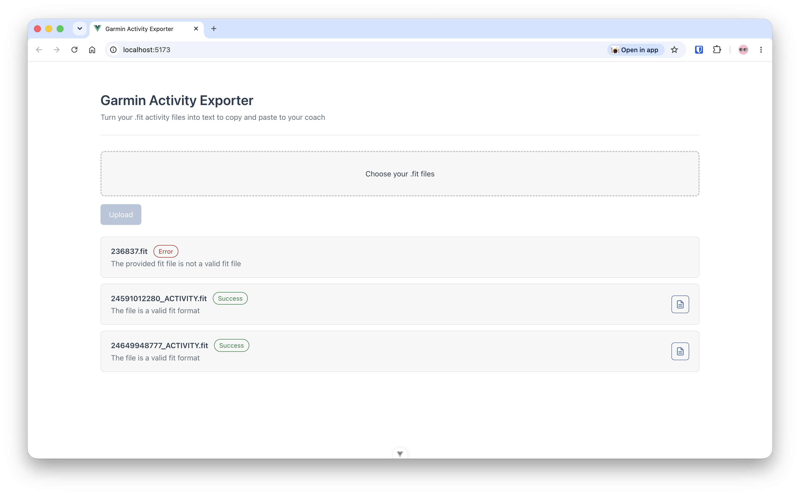
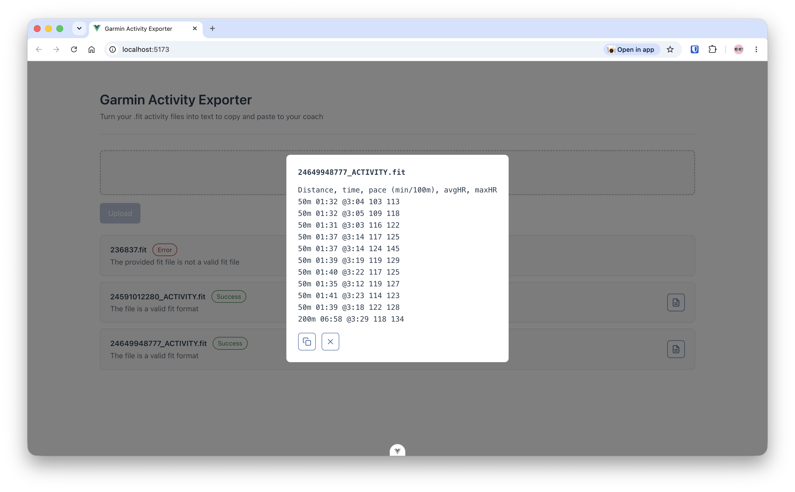
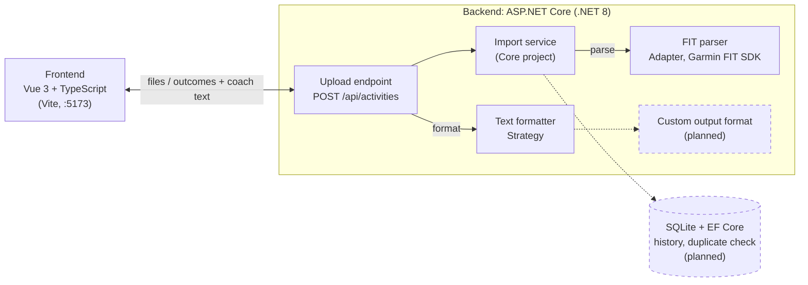

# Garmin Activity Exporter

Web app that imports activity files downloaded from Garmin Connect, parses them, and exports the results as structured plain text, ready to copy and paste to your coach.

> [!NOTE]
> **Work in progress.** This is a portfolio project that I am building step by step, while exploring C#, ASP.NET Core and Vue. You can already upload files from the web page and copy the text for your coach; the history of the activities is still to come. See [Status](#status) for what is done and what is next.

> [!IMPORTANT]
> Unofficial project, not affiliated with or endorsed by Garmin.

## Why

This project started from a personal need. I train with a coach, and every week I had to send him my results by copying numbers by hand from Garmin Connect. It was slow and error-prone.

So I built a tool that reads the activity files exported from Garmin Connect (no official API, no OAuth, no rate limits, and my data stays local) and turns them into a compact, structured text summary I can paste straight into a message to my coach, in a format I designed myself and that it is useful for me and my coach.

## Tech stack

- **Backend:** C# / ASP.NET Core
- **Frontend:** Vue 3 + TypeScript
- **Parsing:** Garmin activity files (`.fit`), read with the official [Garmin FIT SDK](https://www.nuget.org/packages/Garmin.FIT.Sdk) for .NET
- **Tests:** xUnit

## How it works

1. You upload one or more `.fit` files (already extracted, no zip).
2. The backend checks each file (extension, size, integrity), reads it with the FIT SDK and keeps only the **work** of the activity: warm-up, rests and cool-down are left out.
3. For every file it returns an outcome (`Success` or `Error` with a message) and, for the files that worked, the text to paste to your coach: distance, time, pace and heart rate of every split. The pace unit depends on the sport (min/km for running, min/100 m for swimming, km/h for cycling).

Running, swimming and cycling are supported. Your files are processed locally and are not sent to any external service.

## Screenshots

Upload page, with one outcome per file:



The text to paste to your coach, with a button to copy it:



## Architecture



Dashed = planned, not implemented yet.

## Project structure

```
backend/    ASP.NET Core solution
            ActivityExporter.Core    models, interfaces and the import service (no external dependencies)
            ActivityExporter.Api     endpoints, FIT parser, text formatter
            ActivityExporter.Tests   xUnit tests
frontend/   Vue 3 + TypeScript app (Vite)
```

## Getting started

You need the [.NET 8 SDK](https://dotnet.microsoft.com/download) and [Node.js](https://nodejs.org/) 22 or newer. Run the backend and the frontend in two terminals.

### Backend

```bash
cd backend
dotnet run --project ActivityExporter.Api --launch-profile http
```

The API listens on `http://localhost:5171`.

### Frontend

```bash
cd frontend
npm install
npm run dev
```

Open `http://localhost:5173`. During development Vite forwards the requests to `/api` to the backend, so no extra configuration is needed.

### Try the API

With the backend running (the `http` profile listens on port 5171):

```bash
curl -F "files=@/path/to/activity.fit" http://localhost:5171/api/activities
```

### Run the tests

```bash
cd backend
dotnet test
```

## Status

Work in progress.

- [x] Parse `.fit` files (running, swimming, cycling) with the Garmin FIT SDK
- [x] Generate the text for the coach
- [x] Upload API with one outcome per file
- [x] Unit tests (formatter, parser, mapper, import service)
- [x] Web page: upload, outcomes, popup with the text and copy button
- [ ] Frontend tests
- [ ] History of the uploaded activities (local SQLite database)
- [ ] Delete an activity from the history
- [ ] Customizable output format

## Acknowledgements

`.fit` files are read with the [Garmin FIT SDK](https://developer.garmin.com/fit/overview/), used through its official NuGet package under the terms of the [FIT Protocol License Agreement](https://www.nuget.org/packages/Garmin.FIT.Sdk/21.218.0/License). The SDK itself is not included in this repository: it is restored from NuGet at build time.

## License

MIT
